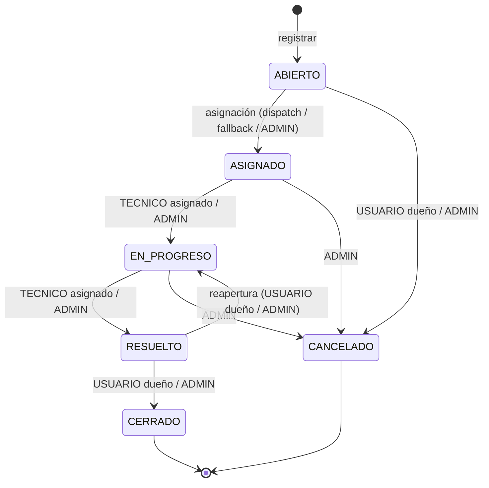
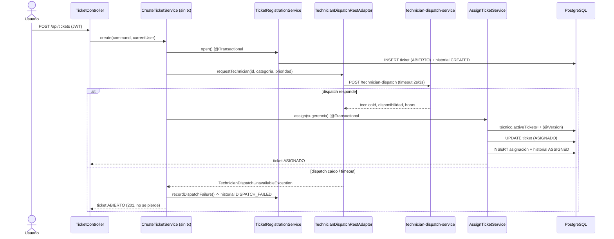
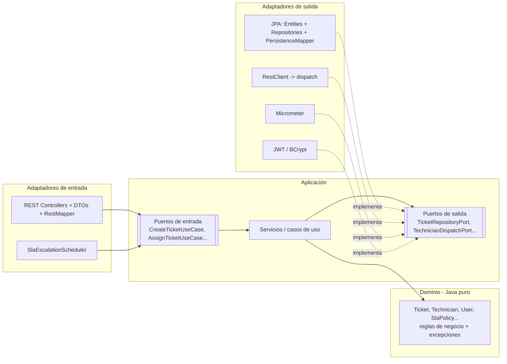
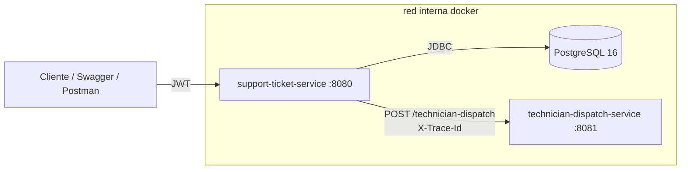
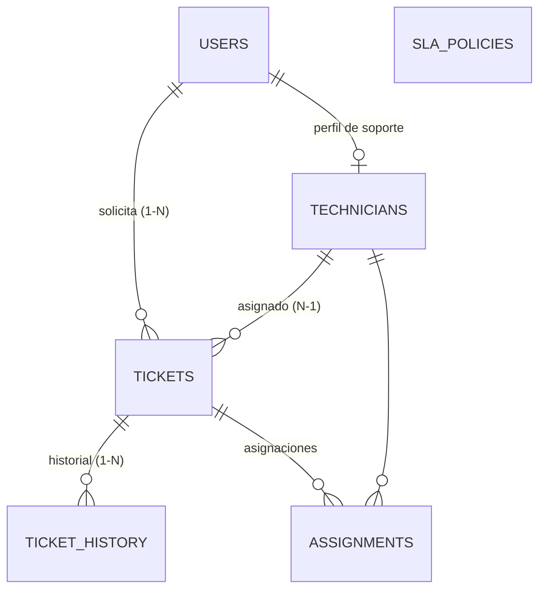

# HelpFlow — Sistema Integral de Gestión de Soporte TI

Sistema compuesto por dos microservicios para registrar, priorizar, asignar, escalar y cerrar tickets de soporte
tecnológico en una empresa con varias sedes.

| Servicio | Puerto | Responsabilidad |
|---|---|---|
| `support-ticket-service` | 8080 | Tickets, usuarios, técnicos, SLA, seguridad JWT, métricas. **Arquitectura hexagonal.** |
| `technician-dispatch-service` | 8081 | Simula la disponibilidad técnica: técnico sugerido + horas estimadas (determinista). |
| `db` (PostgreSQL 16) | 5432 | Persistencia del servicio principal (esquema gestionado por Flyway). |

**Stack:** Java 21 · Spring Boot 3.5.6 · Maven · PostgreSQL 16 · Flyway · Spring Data JPA/Hibernate · Spring Security
+ JJWT 0.12 · MapStruct 1.6 · Lombok · Bean Validation · springdoc-openapi · Actuator + Micrometer + Prometheus ·
JUnit 5 · Mockito · MockMvc · Testcontainers · Docker multi-stage + Docker Compose.

---

## 1. Cómo ejecutarlo

### Con Docker Compose (recomendado)
```bash
docker compose up --build -d
```
- API: http://localhost:8080 · Swagger: http://localhost:8080/swagger-ui.html
- Dispatch: http://localhost:8081/technician-dispatch

Si los puertos 8080 o 5432 ya están ocupados en tu máquina:
```bash
APP_PORT=8088 DB_PORT=5433 docker compose up --build -d
```

Variables (todas tienen valor por defecto): `DB_NAME`, `DB_USER`, `DB_PASSWORD`, `JWT_SECRET` (Base64, ≥ 256 bits),
`APP_PORT`, `DISPATCH_PORT`, `DB_PORT`, `METRICS_SCRAPER_PASSWORD`, `PROMETHEUS_PORT`, `GRAFANA_PORT`,
`GRAFANA_USER`, `GRAFANA_PASSWORD`. Dentro de la red interna el servicio principal llama a dispatch por el
**nombre del servicio**: `DISPATCH_URL=http://technician-dispatch-service:8081`.

### Con monitoreo (Prometheus + Grafana)
```bash
docker compose --profile monitoring up --build -d
```
- Grafana: http://localhost:3000 — abre directamente el dashboard **HelpFlow - Soporte TI** (lectura sin login;
  para editar, usuario `admin` / `admin`).
- Prometheus: http://localhost:9090 (en *Status → Targets* el job `support-ticket-service` debe estar `UP`).

El perfil `monitoring` es opcional: `docker compose up` sin él levanta solo la BD y los dos servicios. Para incluirlo
siempre, agrega `COMPOSE_PROFILES=monitoring` a un archivo `.env`.

### En local (sin Docker para las apps)
```bash
docker compose up -d db
cd technician-dispatch-service && mvn spring-boot:run
cd support-ticket-service && mvn spring-boot:run
```
Para ver los logs en texto plano en vez de JSON: `LOG_FORMAT= mvn spring-boot:run`.

### Flujo en Swagger
1. `POST /auth/login` con un usuario semilla → copia el `token`.
2. Botón **Authorize** → pega el token (sin "Bearer").
3. Llama a cualquier endpoint protegido (p. ej. `GET /api/users/me`).

## 2. Usuarios semilla
Contraseña de todos: **`Password123*`**

| Correo | Rol | Notas |
|---|---|---|
| admin@helpflow.com | ADMIN | Acceso completo |
| tec01@helpflow.com … tec15@helpflow.com | TECNICO | TEC-001…TEC-015, 3 por categoría (una por sede) |
| ana@helpflow.com | USUARIO | MEDELLIN, tiene un ticket **vencido** (evidencia de la métrica) |
| luis@helpflow.com | USUARIO | BOGOTA |
| maria@helpflow.com | USUARIO | BARRANQUILLA, tiene un ticket ABIERTO sin técnico |
| pedro@helpflow.com | USUARIO | **INACTIVO** (no puede iniciar sesión) |

Sedes semilla: **MEDELLIN, BOGOTA y BARRANQUILLA** (el campo sede es texto libre y se guarda en mayúsculas).

| Especialidad | MEDELLIN | BOGOTA | BARRANQUILLA |
|---|---|---|---|
| HARDWARE | TEC-001 | TEC-002 | TEC-011 |
| SOFTWARE | TEC-003 | TEC-004 | TEC-012 |
| RED | TEC-005 | TEC-006 | TEC-013 |
| ACCESOS | TEC-007 | TEC-008 | TEC-014 |
| OTRO | TEC-009 | TEC-010 | TEC-015 |

Cada técnico tiene **documento, nombre, salario, fecha de afiliación y estado** (ACTIVO / INACTIVO), más su perfil
de soporte (especialidad, sede, carga máxima y tickets activos). Documento y nombre se guardan una sola vez en
`users` (el técnico es un usuario con rol TECNICO); salario y fecha de afiliación en `technicians`.
Reglas: salario > 0 y fecha de afiliación no futura (400 en la API, 422 si llega al dominio).

## 3. Endpoints

| Método | Ruta | Roles | Descripción |
|---|---|---|---|
| POST | `/auth/register` | público | Registro (rol USUARIO, correo `@helpflow.com`) |
| POST | `/auth/login` | público | Devuelve el JWT |
| GET / PUT | `/api/users/me` | autenticado | Ver / editar mi información básica |
| GET | `/api/users` | ADMIN | Listar usuarios (paginado) |
| PATCH | `/api/users/{id}/status` | ADMIN | Activar / inactivar |
| POST / GET | `/api/technicians` | ADMIN | Crear técnico (usuario TECNICO + salario, afiliación y perfil) / listar con su carga |
| PUT | `/api/technicians/{id}` | ADMIN | Editar perfil de soporte (especialidad, sede, salario, carga, estado) |
| POST | `/api/tickets` | USUARIO, ADMIN | Registrar ticket → consulta dispatch → asignación inicial |
| GET | `/api/tickets?status=&priority=&page=&size=` | todos | USUARIO: los suyos · TECNICO: asignados · ADMIN: todos |
| GET | `/api/tickets/{id}` | todos | Detalle (403 si no es suyo / no está asignado a él) |
| GET | `/api/tickets/{id}/history` | todos | Trazabilidad del ticket |
| PATCH | `/api/tickets/{id}/status` | todos | Cambio de estado con observación (reglas por rol) |
| POST | `/api/tickets/{id}/auto-assign` | ADMIN | Reintenta la asignación con dispatch (503 si no responde) |
| PUT | `/api/tickets/{id}/assignment` | ADMIN | Reasignación manual |
| POST | `/api/tickets/escalations/run` | ADMIN | Ejecuta ya el escalamiento por SLA |
| GET | `/api/sla-policies` | ADMIN | Políticas de SLA |
| PUT | `/api/sla-policies/{priority}` | ADMIN | Configurar SLA |
| GET | `/actuator/health`, `/actuator/info` | público | Salud e información |
| GET | `/actuator/metrics` | ADMIN | Métricas |
| GET | `/actuator/prometheus` | ADMIN o credencial técnica `prometheus` (HTTP Basic) | Métricas para Prometheus |
| POST | `:8081/technician-dispatch` | (interno) | `{ticketId, categoria, prioridad}` → `{ticketId, tecnicoId, disponibilidad, tiempoEstimadoHoras}` |

## 4. Reglas de negocio

### Ciclo de vida del ticket

- Toda transición manual exige **observación** (cancelar: mínimo 15 caracteres). `ASIGNADO` solo se alcanza por asignación.
- Pasar a `EN_PROGRESO` registra la **primera respuesta**; a `RESUELTO`, la **resolución** (alimentan los timers).
- Resolver o cancelar **libera** la carga del técnico; reabrir la vuelve a tomar.

### SLA
| Prioridad | Respuesta | Resolución (fecha límite) |
|---|---|---|
| CRITICA | 1 h | 4 h |
| ALTA | 2 h | 8 h |
| MEDIA | 4 h | 24 h |
| BAJA | 8 h | 72 h |

Configurable por ADMIN (aplica a tickets nuevos). **Escalamiento automático** cada 5 min: un ticket activo con
≤ 20 % de su ventana de SLA restante sube un nivel de prioridad (una sola vez) y queda marcado `escalated`.
La fecha límite no cambia.

### Flujo de asignación (operación crítica)
Reglas internas que el técnico sugerido debe cumplir: **activo**, **especialidad compatible** con la categoría
(OTRO acepta cualquiera), **carga** < máximo, **misma sede** (salvo prioridad CRITICA) y **cumplimiento del SLA**
(`ahora + horas estimadas ≤ fecha límite`). Si no cumple, se elige un técnico local compatible de menor carga
(FALLBACK). Si nadie cumple, el ticket queda ABIERTO con historial.



## 5. Arquitectura

### Hexagonal (support-ticket-service)

Regla de dependencias: `infrastructure → application → domain`. El dominio no importa Spring, JPA, Jakarta ni Lombok.

### Relación entre microservicios


### Modelo de datos


## 6. Errores (ProblemDetail RFC 7807)
Todas las respuestas de error tienen `type`, `title`, `status`, `detail`, `instance`, `timestamp` y `traceId`.

| Código | Cuándo |
|---|---|
| 400 | Validación de Bean Validation (con `errors` por campo), JSON mal formado, enum o parámetro inválido |
| 401 | Sin token, token inválido/expirado, credenciales inválidas |
| 403 | Rol sin permiso (`@PreAuthorize`) o recurso ajeno / transición no permitida para su rol |
| 404 | Recurso no encontrado |
| 409 | Duplicado, transición de estado inválida, técnico sin capacidad, `DataIntegrityViolationException`, concurrencia (`@Version`) |
| 422 | Regla de dominio violada (usuario inactivo, especialidad incompatible...) |
| 501 | Funcionalidad pendiente (solo mientras queden TODO del modo estudio) |
| 503 | `technician-dispatch-service` caído o lento |
| 500 | Error inesperado (registrado con `log.error` y traceId) |

Ejemplo:
```json
{
  "type": "https://helpflow.com/errors/unauthorized",
  "title": "No autenticado",
  "status": 401,
  "detail": "Se requiere autenticación (token Bearer)",
  "instance": "/api/tickets",
  "timestamp": "2026-10-27T19:22:04.902Z",
  "traceId": "5671e14648504a6fa9fd08e668569c46"
}
```

## 7. Observabilidad
| Métrica | Tipo | Qué mide |
|---|---|---|
| `helpflow.tickets.created{category,priority}` | counter | Tickets creados por categoría y prioridad |
| `helpflow.tickets.overdue` | gauge (COUNT) | Tickets activos con SLA vencido |
| `helpflow.tickets.first_response.time` | timer | Tiempo medio de primera respuesta (sum/count) |
| `helpflow.tickets.resolution.time` | timer | Tiempo medio de resolución |
| `helpflow.tickets.assigned{origin}` | counter | Asignaciones DISPATCH / FALLBACK / MANUAL |
| `helpflow.tickets.status_changed{to}` | counter | Cambios de estado |
| `helpflow.tickets.escalated` | counter | Escalamientos por SLA |
| `helpflow.auth.failures{reason}` | counter | Fallas de autenticación |
| `helpflow.access.denied{source}` | counter | Accesos denegados (role / ownership) |
| `helpflow.dispatch.time{outcome}` | timer | Latencia de dispatch (success / error) |
| `helpflow.errors{status,exception}` | counter | Errores devueltos: distingue 500 (BD/código) de 503 (externo) |

En formato Prometheus los puntos pasan a `_` y los contadores llevan `_total`. Ojo: `helpflow.tickets.created` se
publica como `helpflow_tickets_total`, porque el cliente de Prometheus reserva el sufijo `_created`.

**Dashboard (Grafana).** Con el perfil `monitoring`, Prometheus lee `/actuator/prometheus` cada 15 s y Grafana
muestra el dashboard provisionado desde `monitoring/grafana/dashboards/helpflow.json`: resumen (creados, vencidos,
escalados, 5xx), tickets por categoría/prioridad/origen de asignación, tiempos medios de primera respuesta y
resolución, latencia de dispatch, errores, 401/403, peticiones HTTP y memoria de la JVM.

¿Cómo se autentica Prometheus si la API usa JWT? Prometheus no sabe hacer login ni renovar un token, así que
`/actuator/prometheus` tiene su propia cadena de seguridad que acepta, además del JWT de ADMIN, **HTTP Basic** con una
credencial técnica (rol `METRICS`, contraseña `METRICS_SCRAPER_PASSWORD`). Esa credencial no sirve para ningún otro
endpoint. Sin contraseña configurada, el usuario técnico no existe.

Logs **estructurados** en formato ECS (JSON) con `traceId` en cada línea (MDC). El `traceId` se devuelve en el header
`X-Trace-Id`, en los ProblemDetail y se propaga a dispatch.

## 8. Pruebas
```bash
cd support-ticket-service
mvn test                       # unitarias: dominio (sin mocks) y casos de uso (Mockito, TechnicianDispatchPort simulado)
mvn test -Dtest=ApplicationIT  # integración: Spring Boot + MockMvc + PostgreSQL en Testcontainers (requiere Docker)
cd ../technician-dispatch-service && mvn test
```
- Las pruebas de integración usan `@ServiceConnection` y aplican Flyway sobre un PostgreSQL 16 real; cada prueba crea
  sus propios datos únicos. Cubren JWT, roles, propiedad, validaciones, ProblemDetail, métricas y el flujo de tickets.

## 9. Decisiones técnicas
| Decisión | Por qué |
|---|---|
| Documento y nombre del técnico en `users`, salario y afiliación en `technicians` | El técnico es un usuario (inicia sesión con rol TECNICO): duplicar documento y nombre rompería la unicidad y podría desincronizarse. Los listados traen el usuario con `@EntityGraph` |
| Dominio con relaciones por id (`requesterId`, `technicianId`) | El dominio no navega entidades JPA ni depende de lazy loading |
| `CurrentUser` record de dominio como principal | Los casos de uso reciben quién actúa sin depender de Spring Security |
| Propiedad en el caso de uso, rol en el controller | El rol es una regla de acceso HTTP; "este ticket es suyo" es regla de negocio |
| `CreateTicketService` sin `@Transactional` | No retener una conexión de BD mientras se espera la respuesta HTTP de dispatch |
| Asignación en un único `@Transactional` (bean aparte) | Asignación + historial + carga del técnico: todo o nada. Bean aparte porque `@Transactional` funciona por proxy (la auto-invocación lo ignoraría) |
| Si dispatch cae, el ticket se crea igual (ABIERTO) | El problema #1 del enunciado son los tickets extraviados; el 503 aparece en el reintento `auto-assign` |
| `@Version` en Ticket y Technician | Dos asignaciones simultáneas al mismo técnico no pueden superar su carga: la segunda recibe 409 |
| `activeTickets` como contador en el técnico | Regla de carga O(1) y protegida por `@Version`, en vez de un COUNT con condición de carrera |
| `@EntityGraph` en el listado + `TicketSummary` | Mostrar solicitante y técnico sin N+1 |
| Índice único parcial `WHERE active` en asignaciones | La BD garantiza una sola asignación activa por ticket |
| Dispatch con CRC32 | Determinista entre reinicios y JVMs (`String.hashCode` también lo es, pero CRC32 distribuye mejor) |
| Catálogo de dispatch por categoría | Simula un servicio que conoce especialidades; las reglas internas (sede, carga, SLA) siguen decidiendo |
| `Clock` inyectable | Pruebas de SLA deterministas |
| `RestClient.Builder` autoconfigurado con `spring.http.client.factory=simple` | Se usa el builder de Spring Boot (métricas `http.client.requests` incluidas) con timeouts por propiedades (2 s / 3 s); la fábrica `simple` (HttpURLConnection) evita el `HttpClient` del JDK, que falla al iniciar en algunos Windows |
| Testcontainers 1.21.4 | La 1.21.3 que trae Boot 3.5.6 no habla con Docker Engine 29+ |
| 501 para TODO pendientes | Modo estudio: la API indica claramente qué falta implementar |
