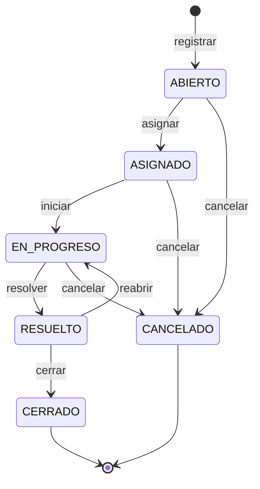
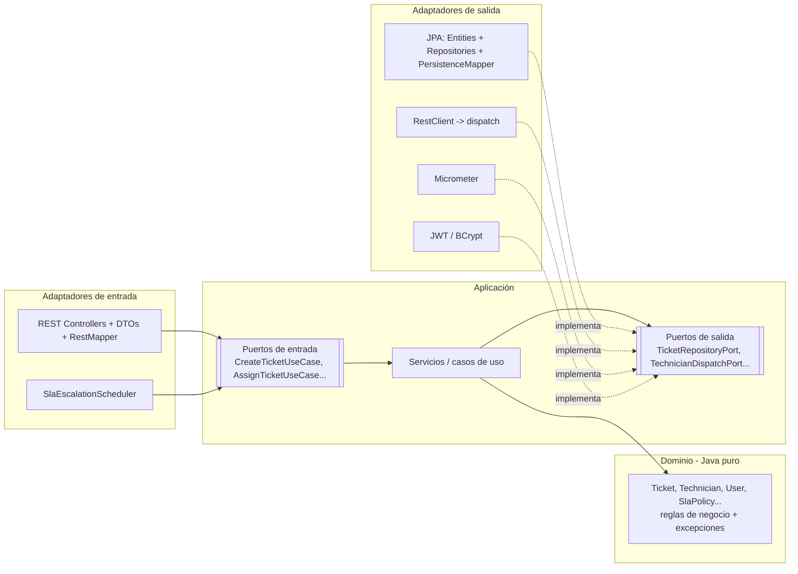
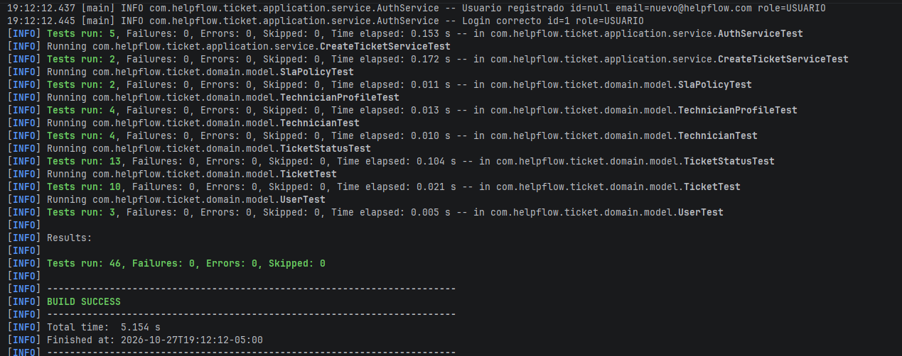
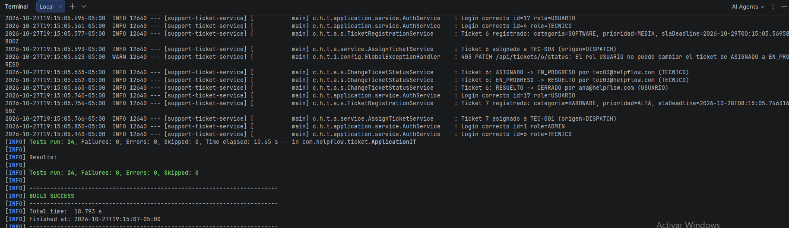
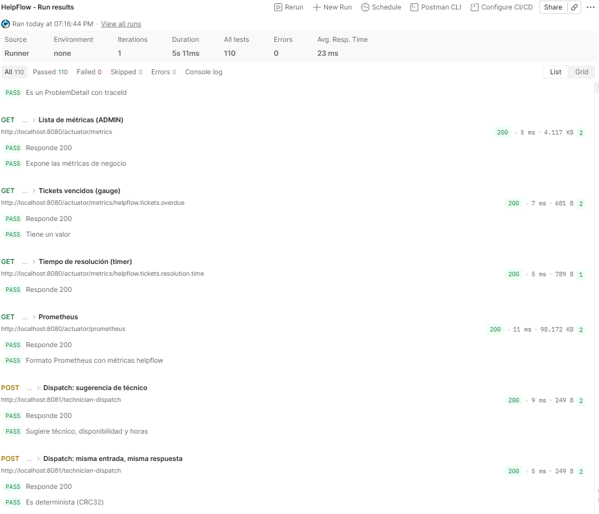
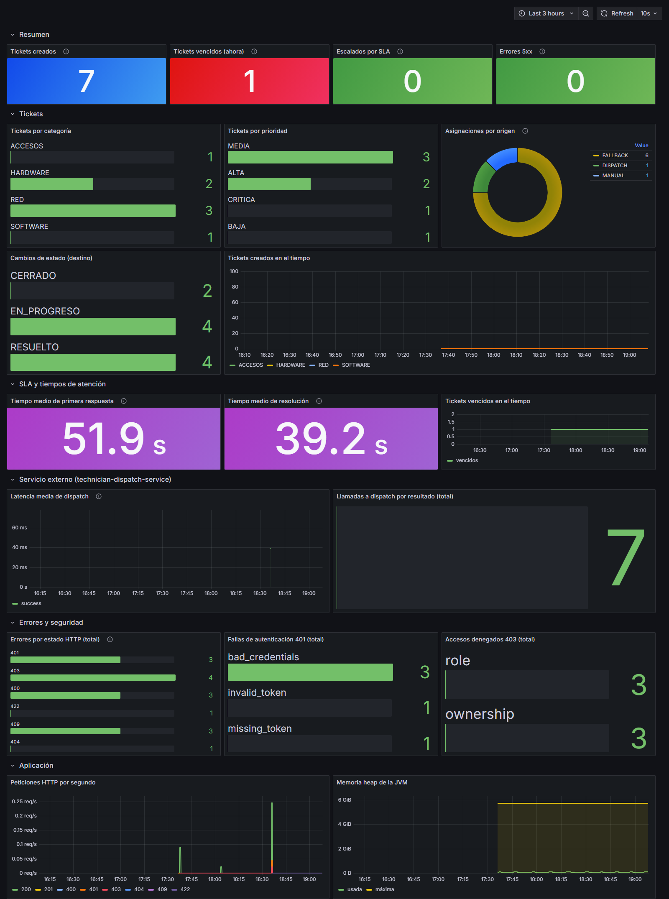
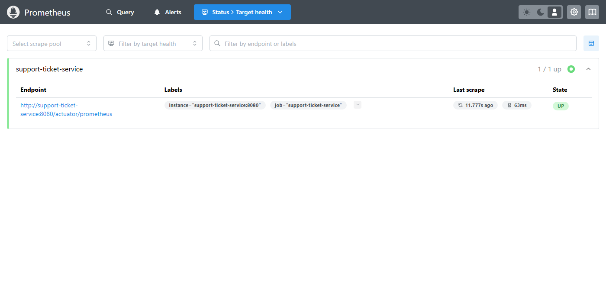
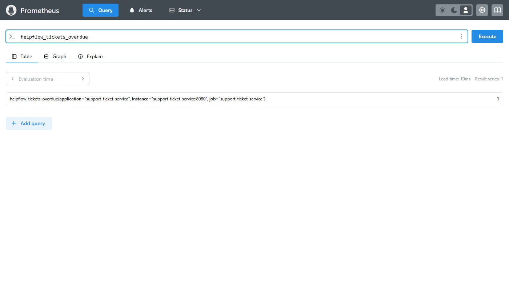
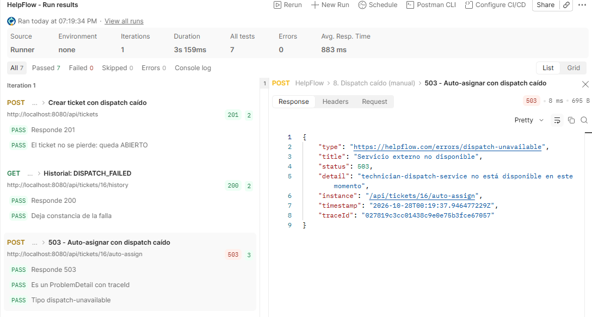
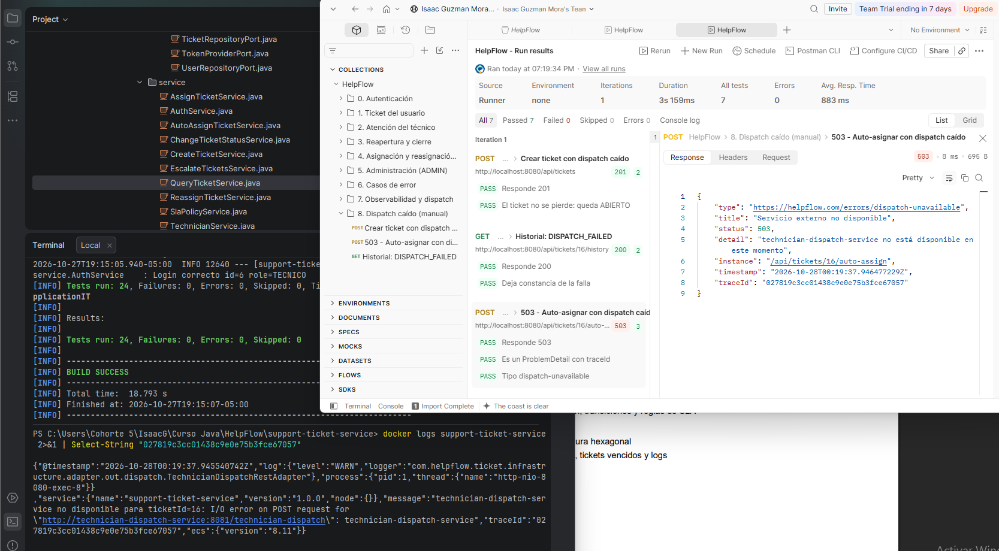

# HelpFlow — Sistema Integral de Gestión de Soporte TI

## 1. Descripción del sistema
HelpFlow registra, prioriza, asigna, escala y cierra tickets de soporte tecnológico en una empresa con varias sedes.
Centraliza solicitudes que antes llegaban por canales informales y se extraviaban, sin saber quién las atendía ni
cuánto tardaban.

- **Registro** de tickets por usuarios activos (categoría, prioridad, sede y activo afectado).
- **Asignación automática** consultando un servicio externo de disponibilidad y validando reglas internas
  (especialidad, sede, carga y SLA), con técnico de respaldo si el sugerido no cumple.
- **SLA por prioridad** con detección de tickets vencidos y **escalamiento automático**.
- **Ciclo de vida** controlado por una máquina de estados con permisos por rol e historial completo.
- **Seguridad JWT** con tres roles y **observabilidad** (métricas, logs estructurados y `traceId`).

| Servicio | Puerto | Responsabilidad |
|---|---|---|
| `support-ticket-service` | 8080 | Tickets, usuarios, técnicos, SLA, seguridad JWT y métricas. **Arquitectura hexagonal** |
| `technician-dispatch-service` | 8081 | Simula la disponibilidad técnica: técnico sugerido + horas estimadas (determinista) |
| `db` (PostgreSQL 16) | 5432 | Persistencia (esquema y datos semilla con Flyway) |
| `prometheus` / `grafana` | 9090 / 3000 | Recolección y dashboard de métricas |

**Stack:** Java 21 · Spring Boot 3.5.6 · Maven · PostgreSQL 16 · Flyway · JPA/Hibernate · Spring Security + JWT ·
MapStruct · Bean Validation · springdoc-openapi · Actuator + Micrometer · JUnit 5 · Mockito · Testcontainers ·
Docker Compose · Prometheus + Grafana.

## 2. Instrucciones de ejecución

### Con Docker Compose
```bash
docker compose up --build -d
```
Levanta los 5 contenedores (PostgreSQL, los dos microservicios, Prometheus y Grafana).

| Recurso | URL |
|---|---|
| API / Swagger | http://localhost:8080 · http://localhost:8080/swagger-ui.html |
| Dispatch | http://localhost:8081/technician-dispatch |
| Grafana (dashboard HelpFlow, sin login) | http://localhost:3000 |
| Prometheus | http://localhost:9090 |

Si los puertos 8080 o 5432 ya están ocupados: `APP_PORT=8088 DB_PORT=5433 docker compose up --build -d`.

### En local
Requisitos: Java 21, Maven 3.9 y Docker (solo para la base de datos).
```bash
docker compose up -d db                                   # 1. PostgreSQL
cd technician-dispatch-service && mvn spring-boot:run     # 2. en una terminal (puerto 8081)
cd support-ticket-service && mvn spring-boot:run          # 3. en otra terminal (puerto 8080)
```
Si la BD quedó en otro puerto: `DB_URL=jdbc:postgresql://localhost:5433/helpflow mvn spring-boot:run`.

### Probar la API
- **Swagger:** `POST /auth/login` con un usuario semilla → botón **Authorize** → pega el token.
- **Postman:** el
  [workspace público](https://www.postman.com/isaac-g17-1927607/isaac-guzman-mora-s-workspace). Con **Run collection**
  corre el flujo completo y los casos de error (sin la carpeta 8, que requiere detener dispatch).

## 3. Roles
| Rol | Qué puede hacer |
|---|---|
| **USUARIO** | Registrarse; crear tickets; ver, listar y consultar el historial **solo de los suyos**; cancelar su ticket ABIERTO; cerrar o reabrir su ticket RESUELTO |
| **TECNICO** | Ver **solo los tickets asignados a él**; iniciar la atención y resolver |
| **ADMIN** | Todo sobre cualquier ticket; reintentar asignación, reasignar y escalar; gestionar usuarios, técnicos y SLA; ver métricas |

El **rol** se valida en el controller (`@PreAuthorize`) y la **propiedad** ("¿es su ticket?") en el caso de uso.

**Usuarios semilla** (contraseña `Password123*`):

| Correo | Rol | Notas |
|---|---|---|
| admin@helpflow.com | ADMIN | |
| tec01@ … tec15@helpflow.com | TECNICO | 3 por categoría, uno por sede (MEDELLIN, BOGOTA, BARRANQUILLA) |
| ana@helpflow.com | USUARIO | Tiene un ticket **vencido** |
| luis@helpflow.com / maria@helpflow.com | USUARIO | |
| pedro@helpflow.com | USUARIO | **INACTIVO** (no puede iniciar sesión) |

## 4. Endpoints
| Método | Ruta | Roles | Descripción |
|---|---|---|---|
| POST | `/auth/register` | público | Registro (rol USUARIO, correo `@helpflow.com`) |
| POST | `/auth/login` | público | Devuelve el JWT |
| GET / PUT | `/api/users/me` | autenticado | Ver / editar mi información |
| GET | `/api/users` | ADMIN | Listar usuarios |
| PATCH | `/api/users/{id}/status` | ADMIN | Activar / inactivar |
| POST / GET | `/api/technicians` | ADMIN | Crear técnico / listar con su carga |
| PUT | `/api/technicians/{id}` | ADMIN | Editar perfil de soporte |
| POST | `/api/tickets` | USUARIO, ADMIN | Registrar ticket → consulta dispatch → asignación inicial |
| GET | `/api/tickets?status=&priority=&page=&size=` | todos | USUARIO: los suyos · TECNICO: asignados · ADMIN: todos |
| GET | `/api/tickets/{id}` | todos | Detalle |
| GET | `/api/tickets/{id}/history` | todos | Historial del ticket |
| PATCH | `/api/tickets/{id}/status` | todos | Cambio de estado con observación |
| POST | `/api/tickets/{id}/auto-assign` | ADMIN | Reintenta la asignación con dispatch (503 si no responde) |
| PUT | `/api/tickets/{id}/assignment` | ADMIN | Reasignación manual |
| POST | `/api/tickets/escalations/run` | ADMIN | Ejecuta el escalamiento por SLA |
| GET / PUT | `/api/sla-policies`, `/api/sla-policies/{priority}` | ADMIN | Ver / configurar SLA |
| GET | `/actuator/health`, `/actuator/info` | público | Salud e información |
| GET | `/actuator/metrics`, `/actuator/prometheus` | ADMIN | Métricas |
| POST | `:8081/technician-dispatch` | interno | `{ticketId, categoria, prioridad}` → `{ticketId, tecnicoId, disponibilidad, tiempoEstimadoHoras}` |

Los errores responden con `ProblemDetail` (`type`, `title`, `status`, `detail`, `instance`, `timestamp`, `traceId`):
400 validación · 401 sin autenticar · 403 rol o recurso ajeno · 404 · 409 estado/duplicado/concurrencia ·
422 regla de dominio · 503 dispatch no disponible.

## 5. Reglas de negocio

### Transiciones

| Transición | USUARIO (dueño) | TECNICO (asignado) | ADMIN |
|---|---|---|---|
| ABIERTO → CANCELADO | ✅ | — | ✅ |
| ASIGNADO → EN_PROGRESO | — | ✅ | ✅ |
| EN_PROGRESO → RESUELTO | — | ✅ | ✅ |
| RESUELTO → CERRADO | ✅ | — | ✅ |
| RESUELTO → EN_PROGRESO (reapertura) | ✅ | — | ✅ |
| ASIGNADO / EN_PROGRESO → CANCELADO | — | — | ✅ |

- Una transición inexistente (p. ej. ASIGNADO → RESUELTO) responde **409**; una válida que el rol no puede hacer, **403**.
- Toda transición exige **observación**. `ASIGNADO` solo se alcanza por asignación.
- `EN_PROGRESO` registra la **primera respuesta** y `RESUELTO` la **resolución**. Resolver o cancelar libera la carga
  del técnico; reabrir la vuelve a tomar.

### Flujo de asignación
1. El usuario registra el ticket: queda **ABIERTO** con su fecha límite de SLA.
2. Se consulta `technician-dispatch-service`, que sugiere un técnico y las horas estimadas.
3. El técnico sugerido debe cumplir las reglas internas: **activo**, **especialidad compatible** (OTRO acepta
   cualquiera), **carga** < máximo, **misma sede** (salvo prioridad CRITICA) y **SLA**
   (`ahora + horas estimadas ≤ fecha límite`).
4. Si no cumple, se usa un técnico local compatible de menor carga. Si nadie cumple, el ticket queda ABIERTO con
   historial.
5. La asignación, el historial y la carga del técnico se guardan en **una sola transacción**.

| Origen | Cuándo |
|---|---|
| `DISPATCH` | El técnico sugerido cumple todas las reglas |
| `FALLBACK` | El sugerido no cumple: técnico local de la misma sede (otra sede solo si es CRITICA), el de menor carga |
| `MANUAL` | Reasignación del ADMIN |

Si dispatch no responde, el ticket **se crea igual** (201, ABIERTO, historial `DISPATCH_FAILED`) y el ADMIN puede
reintentar con `auto-assign` (503 si sigue caído) o asignarlo manualmente.

### SLA
| Prioridad | Respuesta | Resolución (fecha límite) |
|---|---|---|
| CRITICA | 1 h | 4 h |
| ALTA | 2 h | 8 h |
| MEDIA | 4 h | 24 h |
| BAJA | 8 h | 72 h |

- **Fecha límite** = creación + horas de resolución. Configurable por ADMIN (aplica a tickets nuevos).
- **Vencido**: ticket activo (ABIERTO, ASIGNADO o EN_PROGRESO) cuya fecha límite ya pasó.
- **Escalamiento automático** cada 5 min: un ticket activo con ≤ 20 % de su ventana de SLA restante sube un nivel de
  prioridad (BAJA → MEDIA → ALTA → CRITICA), una sola vez. La fecha límite no cambia.

## 6. Arquitectura hexagonal (support-ticket-service)

Regla de dependencias: `infrastructure → application → domain`. El dominio no depende de Spring, JPA ni Lombok.
Los dos servicios se comunican por la red interna de Docker usando el nombre del servicio
(`http://technician-dispatch-service:8081`).

## 7. Pruebas
```bash
cd support-ticket-service
mvn test                       # 46 unitarias: dominio y casos de uso (Mockito)
mvn test -Dtest=ApplicationIT  # 24 de integración: PostgreSQL real con Testcontainers (requiere Docker)
```

**Unitarias:** 46 pruebas, 0 fallos.



**Integración:** 24 pruebas, 0 fallos.



**Colección de Postman** contra el sistema en Docker: 110 tests, 0 fallos.



## 8. Evidencias

### Métricas
Dashboard de Grafana alimentado por `/actuator/prometheus`: tickets creados, vencidos, escalados, asignaciones por
origen, tiempos medios de primera respuesta y resolución, latencia de dispatch, errores y accesos denegados.





### Tickets vencidos
El gauge `helpflow.tickets.overdue` vale **1**: el ticket semilla de ana cuya fecha límite ya pasó.



### Logs
Logs estructurados (JSON/ECS) con `traceId`. Con dispatch detenido, el `auto-assign` responde 503 y el mismo
`traceId` de la respuesta aparece en el log del servidor.




